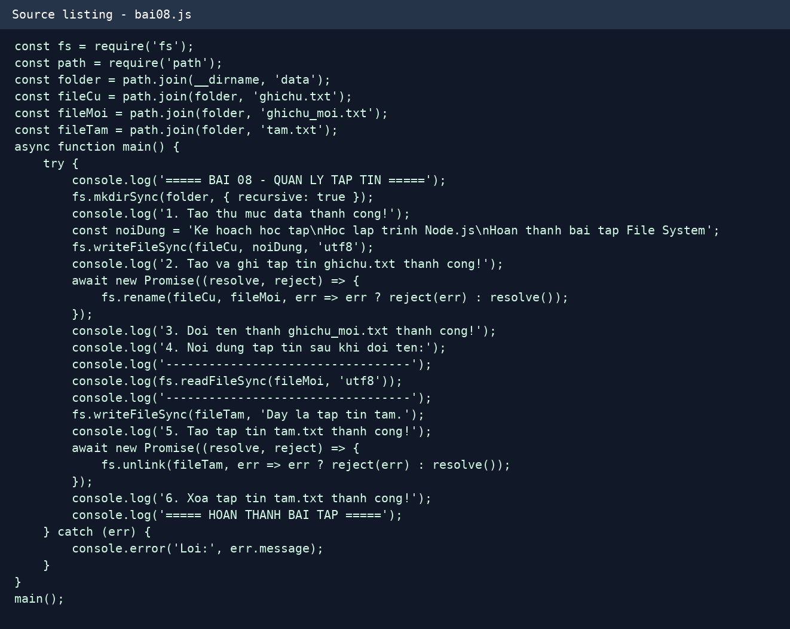
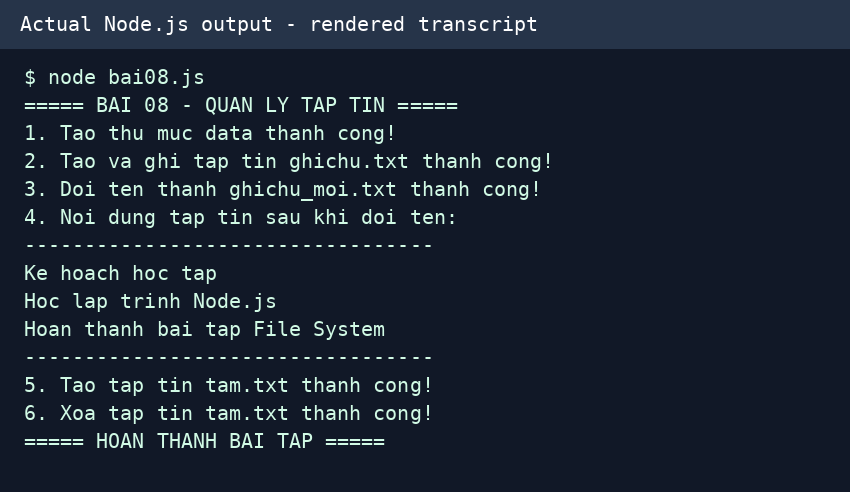
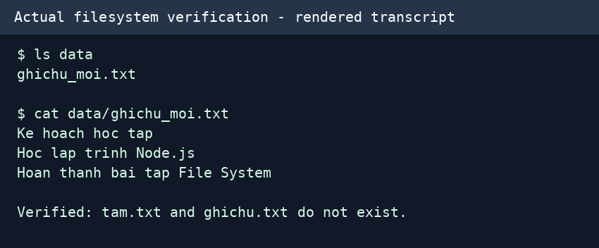

# Bài 08 – Quản lý tập tin và thư mục

## 1. Mục tiêu
Sử dụng module fs trong Node.js để tạo thư mục, ghi, đổi tên, đọc và xóa tập tin.

## 2. Các lệnh thực hiện
- `require('fs')`: sử dụng module File System.
- `fs.mkdirSync()`: tạo thư mục data.
- `fs.writeFileSync()`: tạo và ghi ít nhất 3 dòng vào ghichu.txt.
- `fs.rename()`: đổi tên thành ghichu_moi.txt.
- `fs.readFileSync()`: đọc nội dung sau khi đổi tên.
- `fs.writeFileSync()`: tạo tam.txt.
- `fs.unlink()`: xóa tam.txt.
- `console.log()`: hiển thị thông báo từng thao tác.

## 3. Cách chạy
Mở Terminal tại Bt08 và chạy `node bai08.js`.

## 4. Kết quả
Thư mục data chứa ghichu_moi.txt với ba dòng ghi chú. Tập tin tam.txt đã được xóa.

## 5. Ảnh minh chứng
Các ảnh dưới đây được trình bày lại từ mã nguồn, kết quả chạy Node.js thực tế và kiểm tra hệ thống tập tin trong môi trường kiểm thử. Đây không phải ảnh chụp VS Code trên máy sinh viên. Nếu giáo viên yêu cầu ảnh chụp màn hình cá nhân, hãy thay bằng ảnh trên máy của mình.

## 6. Nộp bài
Đưa thư mục Bt08 lên repository NodeJS tại đường dẫn Bai03/Bt08.
